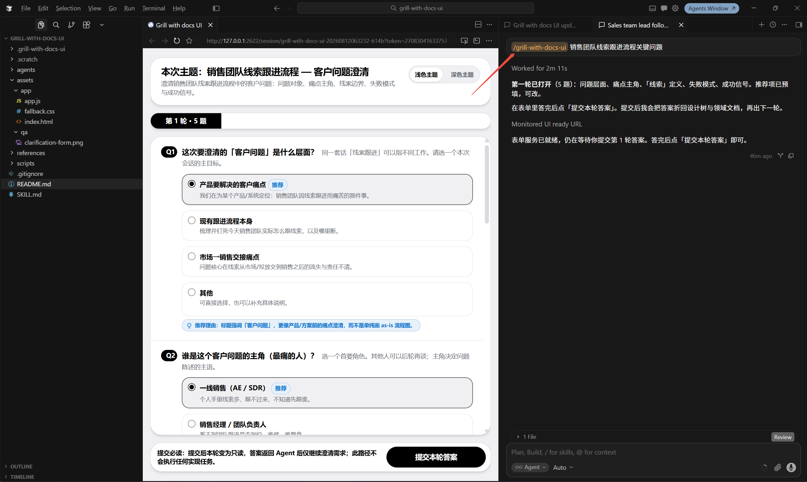
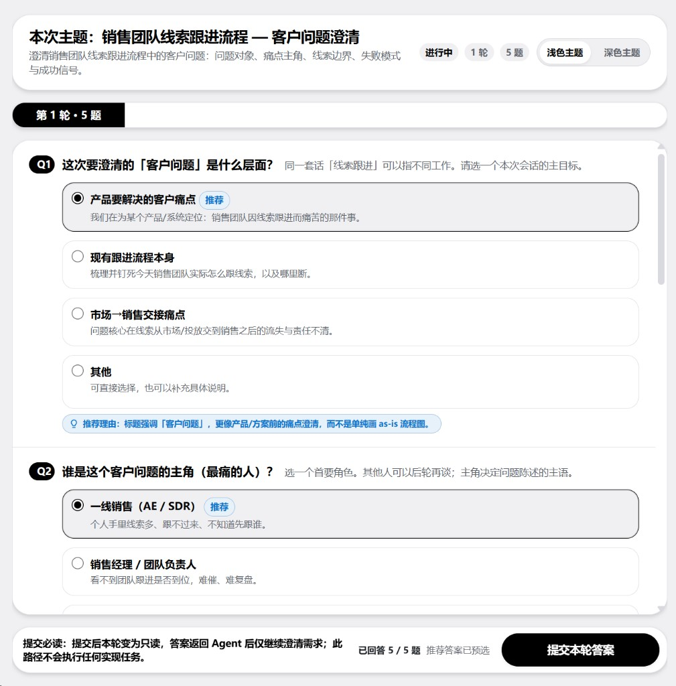

# Grill with docs UI

把 [grill-with-docs](https://github.com/mattpocock/skills)（`grilling` + `domain-modeling`）接到本地表单：frontier ≥ 2 时一次收齐答案，提交后继续澄清并落文档，直到 frontier 为空。

本仓库上游本身 fork 自 [Angus221/ak.skills_sample](https://github.com/Angus221/ak.skills_sample) 的 `ask-ui`。

## 相对上游的改动

上游仓库仍是「多技能示例」（`ask-ui` + `resume-analyzer` + `emp_sample`），README 也仍以 Ask UI 为主。本仓库收成**单一 skill**，并接到 grilling 流程。

| 项 | 上游 | 本仓库 |
| --- | --- | --- |
| 仓库形态 | `skills/ask-ui/` 等多样本 | 根目录即 `grill-with-docs-ui` skill |
| Skill 定位 | 通用多题表单适配器 | **proxy `grill-with-docs`**：执行 grilling + domain-modeling |
| CLI / 数据目录 | `ask-ui.mjs`、`.ask-ui/` | `grill-with-docs-ui.mjs`、`.scratch/grill-with-docs-ui/` |
| 打开浏览器 | 默认打开系统浏览器（`--no-open` 关闭） | **默认不打开**；需显式 `--open`（便于 Agent 内置浏览器） |
| 题号 | 每轮从 Q1 起算 | **跨轮连续编号** |
| 提交文案 | 通用「返回 Agent / 已提交」 | 强调**只澄清、不执行实现** |
| 默认主题 | 跟随系统深浅色 | 默认浅色 |
| 附带内容 | `resume-analyzer`、`emp_sample`、设计 QA 截图 | 已移除多样本；仅保留本 skill 与界面截图 |

工作流差异见 `SKILL.md`：frontier 为空则收束；= 1 走对话；≥ 2 走表单；表单不可用时回退到 grilling 文本提问。

## 目录结构

```text
grill-with-docs-ui/
├── SKILL.md
├── agents/
├── assets/
│   ├── app/             # 本地表单页
│   └── qa/              # 界面截图
├── references/          # JSON 协议与示例
└── scripts/
    ├── grill-with-docs-ui.mjs
    ├── self-test.mjs
    └── adapters/
```

## 依赖

- Node.js（可运行 `node` / `npx`）
- 同环境已安装并可被 Agent 读取的 `grilling`、`domain-modeling` skill

## 安装

项目级（推荐，技能落在当前仓库 `.agents/skills/`）：

```bash
npx --yes skills@latest add <本仓库地址或本地路径> --skill grill-with-docs-ui --agent cursor --yes
```

全局安装可加 `--global`，并按需改 `--agent`（如 `codex`、`claude`）。

安装后可用 `$grill-with-docs-ui` 显式调用，或在匹配 description 时由 Agent 自动选用。

## 使用说明

### 界面一览

frontier ≥ 2 时，Agent 会打开本地表单：主题与轮次在页眉，每题可预选「推荐」项，底部提交本轮答案。提交后本轮只读，答案返回 Agent **仅继续澄清需求**，不会执行实现任务。




### 怎么触发

在对话里说明要澄清的方案，并点名用本 skill，例如：

```text
用 grill-with-docs-ui 帮我澄清这个方案，frontier 多题用表单一次问我。
```

或显式调用：

```text
$grill-with-docs-ui 澄清销售团队线索跟进流程，把当前能答的独立问题做成表单。
```

### 一轮怎么走

1. Agent 载入并遵循 `grilling` + `domain-modeling`，写出当前 **frontier**（仅独立且现在能答的题）。
2. **提问通道**：
   - frontier **空** → 总结共同理解与已写文档，结束（有表单 Session 则 `complete`）。
   - frontier **= 1** → 在对话里直接问（含推荐），等你回答。
   - frontier **≥ 2** → 写入 QuestionSet，启动本地表单，打开页面。
3. 你在表单里改选项（可保留推荐），点「提交本轮答案」。
4. Agent 读取提交 JSON，把答案折回设计树与领域文档，再算下一轮 frontier；同 Session 继续，直到 frontier 为空。

结束后 Agent **停下**；若要写代码或落地实现，需另开指令。

### 表单里你会看到

- 页眉：本次主题、目的、进行中 / 轮次 / 题数，以及浅色 / 深色切换
- 题卡：单选 / 多选等；推荐项带「推荐」标记，并可附推荐理由
- 题号跨轮连续（第 2 轮不会又从 Q1 起算）
- 底栏：已答进度、「推荐答案已预选」、提交按钮与「只澄清不实现」提示

只有一题，或后一题依赖前一题答案时，仍应在对话里逐个问，不走表单。

### 中断恢复

若前台 `ask` 被打断、或页面已提交但 Agent 未继续：在会话里回复「已提交」/「答完了」。Agent 会用 `resume` 读取已提交轮次，再回到澄清循环。

### 常用命令

```text
node scripts/grill-with-docs-ui.mjs ask --input <questions.json>
node scripts/grill-with-docs-ui.mjs create --input <questions.json>
node scripts/grill-with-docs-ui.mjs resume --session <sessionId>
node scripts/grill-with-docs-ui.mjs complete --session <sessionId>
```

- 默认不打开系统浏览器；需要时加 `--open`。
- Agent 场景一般由内置浏览器打开 stderr 中的 `Grill with docs UI ready at <url>`。
- 创建问题 JSON 前阅读 [`references/schema.md`](references/schema.md)。

## 验证

```bash
node scripts/self-test.mjs
```

## 参考

- 上游改造起点：[miaoyinjun/grill-with-docs-ui](https://github.com/miaoyinjun/grill-with-docs-ui)
- 表单能力来源：[Angus221/ak.skills_sample](https://github.com/Angus221/ak.skills_sample)（`ask-ui`）
- [skills CLI](https://www.skills.sh/docs/cli)
